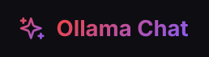
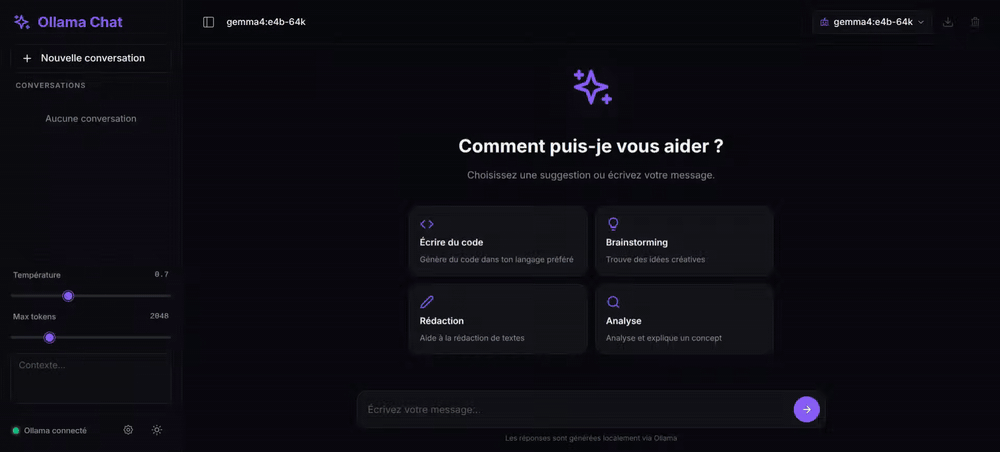

🇬🇧 English | 🇫🇷 [Français](README_fr.md)

<h1 align="center"></h1>

A local web interface for chatting with Ollama models, with conversation storage in MongoDB.

<p align="center"></p>

> [!IMPORTANT]
> **This repository will no longer be maintained after its latest release.**
> For a more actively developed open-source alternative with MCP support, plugins and agents, check out [LibreChat](https://github.com/LibreChat-AI/LibreChat).

## Features

- 💬 **Streaming chat** (NDJSON) with a thinking indicator, typing cursor, and stop button
- 🗂️ **Persisted conversations** — localStorage + MongoDB, auto-generated titles, renaming, **JSON / Markdown** export
- 🎨 **Dark/light design system** — configurable accent color (7 persisted hues), signature gradient, status LED
- ⚙️ **Settings modal** — model selection (size, loaded status), system prompt, temperature, external sources (Claude, GPT, Mistral, Gemini… API keys stored locally only)
- 🔌 **Built-in Ollama proxy** — no more CORS issues: the frontend goes through `/api/ollama/*`
- 🌐 **Bilingual FR/EN interface** — flag language switcher in the top bar, locale in the URL (`/fr`, `/en`), choice remembered in a cookie; auto-generated titles, Markdown export and page metadata follow the interface language
- 📱 **Responsive** — sidebar as a drawer on mobile, touch targets ≥ 44 px, full keyboard navigation and ARIA support

## Stack

- **Frontend**: Next.js 16 (App Router), React 19 (React Compiler), Tailwind CSS v4, TypeScript
- **Backend**: Next.js Route Handlers (Ollama proxy, conversation CRUD)
- **AI**: [Ollama](https://ollama.com) — local models (Llama, Mistral, etc.)
- **Database**: MongoDB (Mongoose 9)
- **Tests**: Vitest 5 + Testing Library (jsdom)
- **Containerization**: Multi-stage Docker on `node:26-alpine` (pnpm 12), Docker Compose
- **Package manager**: **pnpm 12** (pinned via `packageManager`, never npm/yarn)

## Quick start

### Prerequisites

- Node.js 26+ and **pnpm 12** (`npm install -g pnpm@12`: corepack is no longer bundled with Node ≥ 25)
- Docker & Docker Compose (for the containerized stack)
- Ollama installed locally (`ollama serve`)

### Local development (without Docker)

```bash
# 1. Clone and install
pnpm install

# 2. Configure environment variables
cp .env.example .env
# Edit MONGODB_URI if needed

# 3. Start Ollama (in a separate terminal)
ollama serve
ollama pull llama3.2

# 4. Start the dev server
pnpm dev
```

Open [http://localhost:3000](http://localhost:3000) (redirected to `/en` or `/fr`, see [Internationalization](#internationalization)).

### With Docker Compose (recommended)

```bash
# Smart startup:
# - reuses Ollama/Mongo on the host machine if detected and reachable
# - only starts the missing containers
pnpm docker:up:auto

# Stop
docker compose down

# With the MongoDB Express admin UI (optional)
docker compose --profile admin up -d mongo-express
```

| Service | URL |
|---------|-----|
| App | http://localhost:3000 |
| Ollama API | http://localhost:11434 |
| MongoDB | mongodb://localhost:27017 |
| MongoDB Express | http://localhost:8081 |

## Scripts

```bash
pnpm dev            # Development
pnpm build          # Production build
pnpm start          # Start production server
pnpm lint           # ESLint
pnpm test           # Tests (Vitest)
pnpm test:watch     # Tests in watch mode
pnpm test:coverage  # Code coverage
pnpm docker:up:auto # Full Docker stack
```

## API Routes

### Ollama proxy (main entry point used by the frontend)

| Method | Route | Description |
|--------|-------|-------------|
| GET/POST | `/api/ollama/[...path]` | Proxy to the Ollama API (`OLLAMA_HOST`) — removes CORS issues, preserves streaming. E.g. `/api/ollama/api/tags`, `/api/ollama/api/chat` |

### Granular Ollama routes

| Method | Route | Description |
|--------|-------|-------------|
| GET | `/api/ollama/health` | Ollama connectivity |
| GET | `/api/ollama/version` | Ollama version |
| GET | `/api/ollama/tags` | Installed models |
| GET | `/api/ollama/ps` | Models currently loaded in memory |
| POST | `/api/ollama/show` | Model details |
| POST | `/api/ollama/load` | Load a model |
| POST | `/api/ollama/unload` | Unload a model |

### Chat

| Method | Route | Description |
|--------|-------|-------------|
| POST | `/api/chat` | SSE streaming chat (legacy — the frontend uses the NDJSON proxy) |
| POST | `/api/chat/title` | Generate a title |

`/api/chat/title` accepts an optional `locale` (`"fr"` or `"en"`, default `"en"`) in its body: the title is generated in that language.

### Conversations (MongoDB)

| Method | Route | Description |
|--------|-------|-------------|
| GET | `/api/conversations` | List conversations |
| POST | `/api/conversations` | Create a conversation |
| GET | `/api/conversations/[id]` | Fetch a conversation |
| PUT | `/api/conversations/[id]` | Update a conversation |
| DELETE | `/api/conversations/[id]` | Delete a conversation |
| POST | `/api/conversations/[id]/save` | Append messages |

## Internationalization

The interface is available in French and English, without an i18n library (native App Router pattern from the Next.js internationalization guide):

| Piece | Location | Role |
|-------|----------|------|
| Languages | `src/i18n/config.ts` | `fr`, `en` (default); name, flag, Intl locale; `Accept-Language` negotiation |
| Dictionaries | `src/i18n/messages/{fr,en}.ts` | UI strings; `en` is typed after `fr`, a missing key fails the typecheck |
| Routing | `src/proxy.ts` | Redirects locale-less URLs to `/{locale}`: `NEXT_LOCALE` cookie first, then `Accept-Language`, then `en`. `/api`, `/_next` and static files are never redirected |
| Root layout | `src/app/[lang]/layout.tsx` | `<html lang>`, translated `<title>`/description, loads only the current dictionary |
| Client access | `src/i18n/I18nProvider.tsx` | `useI18n()` → `{ locale, t, f, size }` |
| Switcher | `src/components/layout/LanguageSwitcher.tsx` | Flag + `FR`/`EN` in the top bar (flag only on small screens), choice stored in the `NEXT_LOCALE` cookie |

Flags (`public/images/flags/fr.svg`, `gb.svg`) are minimal hand-written SVG renderings of the national flags, used as decoration only (the language name or code is always written next to them).

## Environment variables

Docker variables are kept separate from local Next.js variables:

- `.env.docker`: non-sensitive Docker values (safe to commit)
- `.env.docker.local`: local Docker secrets (not committed)
- `.env.docker.runtime`: auto-generated by `scripts/docker-up-auto.sh` (not committed)

Recommended setup:

```bash
cp .env.docker.local.example .env.docker.local
# then edit .env.docker.local with your private values
```

For the container to reach an Ollama instance installed on the Linux host,
Ollama must listen on `0.0.0.0` (not just `127.0.0.1`):

```bash
OLLAMA_HOST=0.0.0.0:11434 ollama serve
```

Verify with:

```bash
ss -ltn | grep 11434
```

You should see `0.0.0.0:11434` or `[::]:11434`.

| Variable | Description | Default |
|----------|-------------|---------|
| `OLLAMA_HOST` | Target of the `/api/ollama/[...path]` proxy | `http://127.0.0.1:11434` (`http://ollama:11434` in Compose) |
| `OLLAMA_BASE_URL` | Ollama URL used by the granular routes | `http://localhost:11434` |
| `DEFAULT_MODEL` | Default model | `llama3.2` |
| `MONGODB_URI` | MongoDB connection string | — |

> ⚠️ Use `127.0.0.1` rather than `localhost` for `OLLAMA_HOST` outside Docker (avoids IPv6 resolution failures).

## Tests

```bash
pnpm test           # Run the tests
pnpm test:coverage  # Coverage report
```

Current coverage: **97 tests** — UI components (sidebar, messages, streaming, theme, export, deletion, language switcher), internationalization (dictionaries, locale negotiation, proxy, titles generated in the interface language) and type validation.

## CI/CD

GitHub Actions workflows, run on push and pull request to `master` and `development`:

- **Ollama CI** — lint → tests + coverage → typecheck (`tsc --noEmit`) → Next.js build → Docker image published to GHCR on `master` (`master`, `master-<sha>` tags). All Node jobs use pnpm with caching.
- **Release** — on a `vX.Y.Z` tag push, builds and publishes the versioned Docker image (`X.Y.Z`, `X.Y`, `X`, `latest`): `docker pull ghcr.io/alexandre-gouraud/ollama_chat:latest`
- **CodeQL** — JavaScript/TypeScript security analysis (plus a weekly run on Mondays)
- **Dependency Review** — dependency review on pull requests (fails on high+ severity vulnerabilities)
- **Docker Security Scan** — image build + Trivy scan (SARIF uploaded to the Security tab, blocking gate on fixed critical CVEs, plus a filesystem dependency scan; weekly on Wednesdays)

## Agent-assisted development

The project is configured for Claude Code and opencode:

- **`next-devtools` MCP** (`.mcp.json` / `opencode.json`) — real-time app errors, routes, and logs while running `pnpm dev`
- **GitHub MCP** ([`github-mcp-server`](https://github.com/github/github-mcp-server), remote server) — reliable access to GitHub Actions runs, Dependabot alerts, and Dependency Review results when working on CI/CD and dependency updates
- **7 specialized sub-agents** (`.claude/agents/`, `.opencode/agent/`) — `designer` (built-in official design system), `frontend-dev`, `backend-dev`, `code-reviewer`, `test-reviewer`, `ci-reviewer`, `docker-dev`

See `AGENTS.md` for the project's conventions.

## Security

See [SECURITY.md](SECURITY.md) for the supported versions and vulnerability reporting process.

## License

MIT
